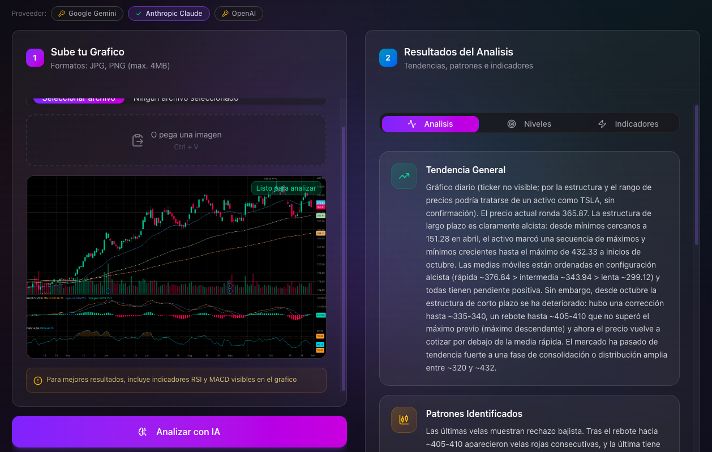

# ProjectIA - Plataforma de Análisis Financiero con IA

Una aplicación full-stack de análisis financiero potenciada por inteligencia artificial, construida con Next.js 16 y React 19. Integra múltiples agentes de IA especializados para búsqueda de noticias en tiempo real y análisis técnico de gráficos bursátiles.

## Demo

**https://chart-analyzer-and-stock-news.vercel.app/**

<p align="center">
  
</p>

## Tabla de Contenidos

- [Demo](#demo)
- [Descripción General](#descripción-general)
- [Arquitectura y Stack Tecnológico](#arquitectura-y-stack-tecnológico)
- [Beneficios de la Arquitectura](#beneficios-de-la-arquitectura)
- [Agentes de IA Integrados](#agentes-de-ia-integrados)
- [Técnicas de Prompt Engineering](#técnicas-de-prompt-engineering)
- [Seguridad](#seguridad)
- [Instalación](#instalación)
- [Uso](#uso)
- [API Reference](#api-reference)
- [Estructura del Proyecto](#estructura-del-proyecto)

---

## Descripción General

ProjectIA es una plataforma profesional que combina dos capacidades fundamentales para el análisis de inversiones:

1. **Búsqueda Avanzada de Noticias**: Utiliza Perplexity AI, Claude u OpenAI (con búsqueda web en tiempo real) para obtener las noticias financieras más relevantes sobre cualquier ticker bursátil.

2. **Análisis Técnico con IA**: Emplea Google Gemini, Claude u OpenAI para analizar imágenes de gráficos de velas japonesas, identificando patrones, niveles de soporte/resistencia e indicadores técnicos.

En cada funcionalidad eliges el proveedor con el selector de la propia página; la elección se guarda en tu navegador.

---

## Arquitectura y Stack Tecnológico

### Stack Principal

| Capa               | Tecnología           | Versión |
| ------------------ | -------------------- | ------- |
| **Framework**      | Next.js (App Router) | 16.0.10 |
| **Runtime**        | React                | 19.2.1  |
| **Lenguaje**       | TypeScript           | 5.x     |
| **Estilos**        | Tailwind CSS         | 4.x     |
| **Componentes UI** | shadcn/ui            | Latest  |
| **Iconos**         | Lucide React         | Latest  |
| **Validación**     | Zod                  | Latest  |
| **IA Framework**   | Google Genkit        | 1.26.0  |

### Proveedores de IA

| Proveedor            | Modelo             | Funcionalidades                                     |
| -------------------- | ------------------ | --------------------------------------------------- |
| **Perplexity AI**    | `sonar-pro`        | Búsqueda de noticias (por defecto)                  |
| **Google Gemini**    | `gemini-2.0-flash` | Análisis técnico (por defecto)                      |
| **Anthropic Claude** | `claude-opus-5-5`  | Análisis técnico y búsqueda de noticias (web search) |
| **OpenAI**           | `gpt-6-astra`      | Análisis técnico y búsqueda de noticias (web search) |

Todas las llamadas se hacen desde el navegador con la API key de cada usuario (BYOK). Los adaptadores de cada proveedor están en `src/services/chart/` y `src/services/news/`, y el registro de proveedores en `src/lib/providers.ts`.

### Estructura de Directorios

```
src/
├── app/                    # App Router de Next.js
│   ├── api/
│   │   └── busqueda/       # Endpoint de búsqueda de noticias
│   ├── busqueda-avanzada/  # Página de búsqueda con IA
│   ├── analisis-tecnico/   # Página de análisis de gráficos
│   ├── error.tsx           # Error boundary
│   └── layout.tsx          # Layout raíz
├── ai/
│   ├── genkit.ts           # Configuración de Google Genkit
│   └── flows/              # Flujos de IA
│       └── technical-analysis-flow.ts
├── components/
│   ├── ui/                 # Componentes shadcn/ui
│   └── shared/             # Componentes compartidos
├── hooks/
│   └── useNewsSearch.ts    # Hook para búsqueda de noticias
├── lib/
│   ├── constants.ts        # Constantes y configuración
│   ├── env.ts              # Validación de variables de entorno
│   ├── logger.ts           # Logger estructurado
│   ├── rate-limit.ts       # Rate limiter
│   └── utils.ts            # Utilidades (cn)
└── types/
    └── index.ts            # Definiciones de tipos TypeScript
```

---

## Beneficios de la Arquitectura

### Next.js 16 con App Router

- **Server Components por defecto**: Reduce el JavaScript enviado al cliente, mejorando el Time to First Byte (TTFB) y el SEO
- **Streaming y Suspense**: Renderizado progresivo para una experiencia de usuario más fluida
- **API Routes integradas**: Backend y frontend unificados en un solo deployment
- **Edge Runtime Ready**: Preparado para ejecución en edge functions con latencia mínima
- **Caché automático**: Optimización de fetch requests con revalidación inteligente

### React 19

- **Concurrent Features**: Renderizado no bloqueante para interfaces más responsivas
- **Server Actions**: Mutaciones de datos simplificadas sin API endpoints adicionales
- **Automatic Batching mejorado**: Menor cantidad de re-renders

### TypeScript Strict Mode

- **Type Safety completo**: Detección de errores en tiempo de compilación
- **IntelliSense mejorado**: Autocompletado y documentación inline
- **Refactoring seguro**: Cambios en el código con confianza
- **Contratos de datos**: Interfaces bien definidas entre componentes y APIs

### Tailwind CSS v4

- **Zero-runtime CSS**: Sin overhead de JavaScript para estilos
- **Purge automático**: Solo se incluye el CSS utilizado
- **Design tokens consistentes**: Sistema de diseño coherente
- **JIT compiler**: Compilación instantánea durante desarrollo

### Zod para Validación

- **Schema-first validation**: Un único source of truth para tipos y validación
- **Runtime safety**: Validación de datos externos (APIs, formularios)
- **Mensajes de error descriptivos**: Feedback claro para debugging
- **Integración TypeScript**: Inferencia de tipos automática desde schemas

### Google Genkit

- **Abstracción de proveedores**: Facilita cambiar entre modelos de IA
- **Flujos tipados**: Input/output con type safety completo
- **Observabilidad integrada**: Tracing y métricas out-of-the-box
- **Testing simplificado**: Flujos fáciles de testear unitariamente

---

## Agentes de IA Integrados

### 1. Agente de Búsqueda de Noticias (Perplexity AI, Claude u OpenAI)

**Modelos**: `sonar-pro` (Perplexity), `claude-opus-5-5` con la herramienta `web_search` (Claude), `gpt-6-astra` con la herramienta `web_search` (OpenAI)
**Propósito**: Búsqueda y síntesis de noticias financieras en tiempo real

#### Configuración (Perplexity)

```typescript
{
  temperature: 0.3,        // Baja aleatoriedad para respuestas factuales
  max_tokens: 2500,        // Límite de respuesta
  search_recency_filter: "month",  // Noticias del último mes
  search_context_size: "high",     // Contexto amplio de búsqueda
  timeout: 30000           // 30 segundos de timeout
}
```

#### Características

- **Acceso a Internet en tiempo real**: Consulta fuentes actualizadas
- **Fuentes verificadas**: Reuters, Bloomberg, Financial Times, WSJ, CNBC
- **Filtrado por relevancia**: Prioriza noticias con impacto en el mercado
- **Clasificación de impacto**: HIGH, MEDIUM, LOW
- **Etiquetado semántico**: earnings, acquisition, regulatory, market, etc.

### 2. Agente de Análisis Técnico (Google Gemini, Claude u OpenAI)

**Modelos**: `gemini-2.0-flash` (Gemini), `claude-opus-5-5` (Claude), `gpt-6-astra` (OpenAI). Claude y OpenAI usan salida estructurada con JSON Schema.
**Propósito**: Análisis visual de gráficos de velas japonesas

#### Capacidades de Análisis

| Categoría             | Elementos Analizados                                |
| --------------------- | --------------------------------------------------- |
| **Tendencia**         | Estructura de altos/bajos, tendencias por timeframe |
| **Patrones de Velas** | Engulfing, Pinbar, Doji, Morning/Evening Star       |
| **Formaciones**       | Triángulos, Banderas, Hombro-Cabeza-Hombro          |
| **Niveles Clave**     | Soportes, Resistencias, Zonas de liquidez           |
| **Indicadores**       | RSI (valor exacto), MACD (cruces y histograma)      |

#### Principios del Agente

- **Solo datos visuales**: No inventa números ni indicadores no visibles
- **Análisis institucional**: Perspectiva de Price Action profesional
- **Cautela y objetividad**: Evita predicciones especulativas
- **Terminología española**: Output localizado para el mercado hispanohablante

---

## Técnicas de Prompt Engineering

Implementamos 8 técnicas avanzadas para respuestas estructuradas y deterministas:

- **Schema-based prompting** - Formato JSON explícito
- **Typed slots** - Campos con tipos y restricciones
- **Descomposición de tareas** - Sub-salidas independientes
- **Contrato estable** - Interfaz inmutable IA-sistema
- **Restricciones explícitas** - Directivas negativas anti-alucinación
- **Formato especificado** - Valores exactos (fechas, enums)
- **Vocabulario controlado** - Conjunto cerrado de categorías
- **Fallback determinista** - Comportamientos por defecto

Ver documentación completa: [docs/PROMPT_ENGINEERING.md](docs/PROMPT_ENGINEERING.md)

---

## Seguridad

- **Headers HTTP**: HSTS, X-Frame-Options, CSP, X-XSS-Protection
- **Validación**: Zod para inputs (ticker, imágenes, env vars)
- **Rate Limiting**: 10 req/min con headers informativos
- **Logging seguro**: Sanitización de datos sensibles
- **API Keys (BYOK)**: cada usuario introduce sus propias keys en `/configuracion`; se guardan solo en su navegador (localStorage) y se envían directamente a cada proveedor

Ver documentación completa: [docs/SECURITY.md](docs/SECURITY.md)

---

## Instalación

### Prerrequisitos

- Node.js 18.x o superior
- npm, yarn, pnpm o bun
- API key de al menos un proveedor por funcionalidad:
  - [Google AI Studio](https://aistudio.google.com/apikey) (Gemini) o [Anthropic](https://platform.claude.com/settings/keys) (Claude) u [OpenAI](https://platform.openai.com/api-keys) para el análisis técnico
  - [Perplexity AI](https://www.perplexity.ai/settings/api), Anthropic u OpenAI para la búsqueda de noticias

### Pasos de Instalación

1. **Clonar el repositorio**

```bash
git clone https://github.com/tu-usuario/projectia.git
cd projectia
```

2. **Instalar dependencias**

```bash
npm install
```

3. **Iniciar servidor de desarrollo**

```bash
npm run dev
```

4. **Abrir en navegador** y configurar tus API keys en `/configuracion`

```
http://localhost:3000
```

### Scripts Disponibles

| Comando         | Descripción                   |
| --------------- | ----------------------------- |
| `npm run dev`   | Inicia servidor de desarrollo |
| `npm run build` | Compila para producción       |
| `npm run start` | Inicia servidor de producción |
| `npm run lint`  | Ejecuta ESLint                |
| `npm test`      | Ejecuta los tests (Vitest)    |

---

## Uso

### Búsqueda Avanzada de Noticias

1. Navegar a `/busqueda-avanzada`
2. Ingresar el ticker de la acción (ej: `AAPL`, `TSLA`, `NVDA`)
3. Hacer clic en "Buscar"
4. Revisar las noticias categorizadas por nivel de impacto

### Análisis Técnico de Gráficos

1. Navegar a `/analisis-tecnico`
2. Subir una imagen de gráfico de velas japonesas:
   - Arrastrar y soltar
   - Pegar desde portapapeles (Ctrl+V)
   - Seleccionar archivo manualmente
3. Esperar el análisis de la IA
4. Revisar resultados en las pestañas:
   - **Análisis**: Tendencia y patrones
   - **Niveles**: Soportes y resistencias
   - **Indicadores**: RSI y MACD

<p align="center">
  
</p>

---

## API Reference

### POST `/api/busqueda`

Busca noticias financieras para un ticker específico.

**Request:**

```typescript
{
  "ticker": "AAPL"  // 1-10 caracteres, alfanumérico
}
```

**Response (200 OK):**

```typescript
{
  "ticker": "AAPL",
  "news": [
    {
      "title": "Apple reporta récord de ingresos en Q4",
      "summary": "La compañía superó expectativas con...",
      "date": "2024-12-10",
      "source": "Reuters",
      "url": "https://reuters.com/...",
      "impact_level": "HIGH",
      "tags": ["earnings", "market"]
    }
  ],
  "usage": {
    "prompt_tokens": 150,
    "completion_tokens": 800,
    "total_tokens": 950
  }
}
```

**Errores:**

| Código | Descripción                |
| ------ | -------------------------- |
| 400    | Ticker inválido            |
| 429    | Rate limit excedido        |
| 500    | Error interno del servidor |
| 504    | Timeout de la API externa  |

**Headers de Caché:**

```
Cache-Control: public, s-maxage=300, stale-while-revalidate=60
```

---

## Estructura del Proyecto

```
ProyectIA/
├── src/
│   ├── app/                       # Next.js App Router
│   │   ├── api/busqueda/route.ts  # API de búsqueda
│   │   ├── busqueda-avanzada/     # Página de búsqueda
│   │   ├── analisis-tecnico/      # Página de análisis
│   │   ├── layout.tsx             # Layout principal
│   │   ├── page.tsx               # Landing page
│   │   ├── error.tsx              # Error boundary
│   │   └── not-found.tsx          # Página 404
│   ├── ai/
│   │   ├── genkit.ts              # Config de Genkit
│   │   └── flows/
│   │       └── technical-analysis-flow.ts
│   ├── components/
│   │   ├── ui/                    # shadcn/ui
│   │   └── shared/                # Componentes comunes
│   ├── hooks/
│   │   └── useNewsSearch.ts       # Hook de búsqueda
│   ├── lib/
│   │   ├── constants.ts           # Configuración
│   │   ├── env.ts                 # Validación de env
│   │   ├── logger.ts              # Logger
│   │   ├── rate-limit.ts          # Rate limiter
│   │   └── utils.ts               # Utilidades
│   └── types/
│       └── index.ts               # Tipos TypeScript
├── public/                        # Assets estáticos
├── .env.local                     # Variables de entorno (no commitear)
├── next.config.ts                 # Config de Next.js
├── tailwind.config.ts             # Config de Tailwind
├── tsconfig.json                  # Config de TypeScript
├── package.json                   # Dependencias
├── CLAUDE.md                      # Instrucciones para Claude
└── README.md                      # Este archivo
```

---

## Licencia

Este proyecto es parte del curso de DevExpert.io.

---

## Créditos

Desarrollado con tecnologías de:
- [Next.js](https://nextjs.org/) - Framework React
- [Tailwind CSS](https://tailwindcss.com/) - Framework CSS
- [shadcn/ui](https://ui.shadcn.com/) - Componentes UI
- [Google Genkit](https://firebase.google.com/docs/genkit) - Framework IA
- [Perplexity AI](https://www.perplexity.ai/) - Búsqueda con IA
- [Google Gemini](https://deepmind.google/technologies/gemini/) - Modelo multimodal
- [Anthropic Claude](https://www.anthropic.com/claude) - Modelo multimodal con búsqueda web
- [OpenAI](https://openai.com/api/) - Modelo multimodal con búsqueda web

<p align="center">
  <a href="https://www.buymeacoffee.com/alvaroqp" target="_blank">
    
  </a>
</p>